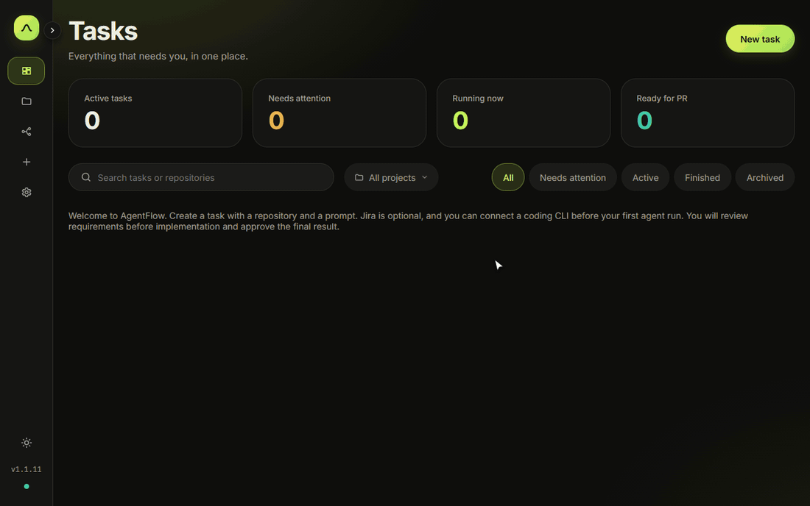
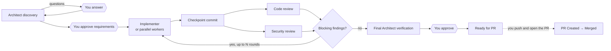

<div align="center">

# AgentFlow

**A deterministic orchestrator for AI coding agents.**

AgentFlow drives Claude Code, Codex, GitHub Copilot CLI or any CLI agent through a fixed,
human-gated engineering workflow: discovery, approved requirements, implementation, parallel code
and security review, and a final assessment. Your Jira ticket (or a plain prompt, since Jira is
optional) is the contract every stage is held to. The agents write the code. AgentFlow's plain,
model-free code decides what happens next, and nothing reaches a pull request without your sign-off.

[](https://github.com/robse7en/AgentFlow/releases/latest)
[](LICENSE)


[Quick start](#quick-start) · [Deterministic by design](#deterministic-by-design) · [Ticket as contract](#the-ticket-is-the-contract) · [How it works](#how-it-works) · [Common concerns](#common-concerns) · [Documentation](#documentation) · [Releases](https://github.com/robse7en/AgentFlow/releases)



<sub>Recorded with a scripted demo agent on a sample repository. Real runs use your own coding CLI.</sub>

</div>

## Why AgentFlow?

Coding agents keep improving. AgentFlow puts a human-gated engineering workflow around the coding
CLIs you already use:

- **You approve the plan and the result.** Requirements and final readiness always need a human.
  Failed tests, open questions, high risk and unresolved review findings block approval. Overriding
  one requires a reason, and the reason is logged.
- **Every task is isolated.** Each task gets its own Git worktree and branch, so agents never touch
  your checkout. Each agent works in its own terminal tab, which you can watch or join at any time.
- **Reviews are independent.** Code and security reviewers inspect the same checkpoint commit, in
  fresh conversations. AgentFlow counts the fix rounds and stops for a human when a finding keeps
  coming back.
- **Bring your own agents.** Mix harnesses per role, for example a Claude Code architect, a Codex
  implementer and a Copilot reviewer. AgentFlow never holds your model credentials.

## Deterministic by design

Most agent frameworks let a model decide what happens next. In AgentFlow, the workflow is plain code,
and the models only work inside the stages it gives them:

| AgentFlow decides, in code | The agents decide, inside their CLI |
|---|---|
| Which stage runs next, and when a human has to approve | How to read the ticket and plan the change |
| Whether a result is accepted: its schema, the checkpoint SHA, an answer for every finding | The code they write and the tests they add |
| How many fix rounds run, and when to stop for a human | What they find in review |
| Which evidence counts: your own verification commands, run against the checkpoint | What they claim about their own work |

- **A fixed workflow graph.** Every task follows the same graph of agent stages, human approvals
  and system steps. System steps, such as consolidating findings and committing checkpoints, involve
  no model at all.
- **No model in the loop.** The backend makes no LLM calls of its own. Routing, consolidation and
  loop counting are ordinary code. Every model call happens inside the coding CLI you configured, on
  your own login. The one exception is opt-in free-text questions in Slack.
- **Contracts, not transcripts.** Agents report through `flowctl` as structured JSON, validated
  against a schema. A malformed or incomplete result is rejected while the agent can still resubmit.
  Terminal output is never parsed. AgentFlow checks the *shape* of what agents report, never the
  quality of their reasoning.
- **A record you can audit.** Every transition, approval and override goes into the task's event log.
  Each run keeps its exact prompt, harness, model, reasoning level and result on disk.
- **One contract, two implementations.** The Python backend and the Rust desktop core are held to the
  same black-box contract suite.

Given the same agent results and the same human decisions, AgentFlow takes the same path every time.
Only the agents' own output varies.

## The ticket is the contract

Start a task from a Jira ticket and the ticket becomes the contract for the whole task. Jira is
optional: without it, the prompt you write plays the same role.

1. **Read from the source.** With the Jira integration on, AgentFlow copies the ticket to disk before
   every Architect run: description, comments, attachments, and keyframes from attached videos. The
   Architect plans from what the ticket says now, never from a stale copy. Without the integration,
   the Architect reads the ticket through its own Jira MCP.
2. **Turned into requirements you sign.** The Architect writes requirements, acceptance criteria,
   assumptions, a plan and risks. When you approve them, AgentFlow freezes those exact documents.
3. **Held to by every stage.** The implementer builds to the approved requirements, both reviewers
   check the checkpoint against them, and the final Architect verification reports whether each one
   is met. Unverified requirements block final approval.
4. **Kept in step with Jira.** The task and its branch are named after the ticket key. The ticket can
   move to *In Progress* when discovery starts (opt-in), and moves to *In Code Review* when the pull
   request is opened (on by default).

That gives every task two contracts: the ticket, with your team, and `flowctl`'s JSON schema, with
the agents. See [Jira integration](docs/configuration.md#agentflows-own-jira-rest-integration-optional).

## Features

| | |
|---|---|
| 🧭 **Architect discovery** | Reads the Jira ticket (or your prompt), explores the code and asks you decision-tree questions before writing requirements. |
| ✅ **Human gates** | You approve the requirements and the final assessment. Approvals are pinned to exact documents and commits. |
| 🛠️ **Direct or parallel implementation** | One implementer, or up to three workers in separate worktrees whose work is merged before review. |
| 🔍 **Parallel code and security review** | Normalised findings (`CODE-001`, `SEC-001`) shown on the reviewed code, with a counted fix loop. |
| 🧪 **Independent verification** | Your own test commands run against the checkpoint. Reviewers see their output, and the implementer's summary is labelled as unverified. |
| 🖥️ **Live terminals** | Each agent runs in a terminal tab you can watch or attach to: built-in terminals in the desktop app, Zellij from source. |
| 🔁 **Retries and recovery** | Retry briefings carry the failed attempt's context. Automatic retries are opt-in. Nothing relaunches without you after a restart. |
| 💸 **Budgets and estimates** | Optional API budgets, metered-launch approvals, and cost estimates based on past runs. |
| 🔗 **GitHub, Jira and Slack** | Notices your PR and its merge, syncs Jira context and status, and DMs you in Slack when a task needs you. |
| 📚 **Reviewed lessons** | Agents propose lessons for their role. You approve them into versioned instructions in your repository. |

## How it works



AgentFlow owns the workflow state, Git worktrees and terminal sessions. The harnesses own the AI
interaction, including their own Jira and Git MCP servers. Agents talk to AgentFlow only through
`flowctl` and structured JSON, never through terminal scraping. See
[How the workflow runs](docs/workflow.md) for the full walkthrough.

## Common concerns

### Won't better models and coding agents make this obsolete?

AgentFlow runs your installed coding CLI. When you upgrade Claude Code, for example, improvements
to its reasoning, code editing and tools remain available inside AgentFlow, subject to your model,
CLI configuration and permissions. AgentFlow does not implement a competing coding agent or freeze
the CLI's toolset. Its responsibility is coordinating stages, approvals, worktrees and evidence.
Breaking changes to a CLI's launch flags or session handling can still require compatibility updates.

### Does orchestration turn an interactive session into a one-shot?

Agents can ask for clarification during a run with `flowctl question`. AgentFlow marks the stage
**WAITING_FOR_USER** and shows the question on the task page and in the **Decisions** inbox; configured
Slack actions can answer it too. Your choice or free-text answer is sent to the waiting agent's
terminal, and the stage returns to running after its last question is answered. You can also attach
to the live terminal for discussion. See [agent questions](docs/workflow.md#agent-questions).

### Do I need a complete specification before I start?

Start with a prompt or Jira ticket. The Architect explores the repository, asks questions and writes
requirements, acceptance criteria, assumptions and a plan for you to review. Implementers are also
instructed to ask when requirements prove impossible or contradictory. This provides a clarification
path; it cannot guarantee an agent will notice every ambiguity. Approval freezes the agreed documents:
changed scope currently requires a new task. See [requirements snapshots](docs/security-and-efficiency.md#routes-and-quality).

### Why trust one agent saying another agent's code is correct?

Code and security reviewers inspect the same checkpoint in fresh conversations. You can configure
verification commands that AgentFlow runs against that checkpoint, recording exit codes and output;
the implementer's own test summary is labelled unverified. Missing or failed verification blocks
ordinary final approval. Reviews and tests provide evidence, not a guarantee of correctness, and you
approve the final result. See [independent verification](docs/security-and-efficiency.md#independent-verification).

### Can agents keep fixing and retrying forever?

AgentFlow counts fix rounds and stops for human review at the configured limit, when a blocking
finding is raised a third time, or when a reviewer upholds a disputed finding. Automatic retries are
off by default and bounded when enabled; interrupted runs need human recovery after a restart.
Optional budgets and metered-launch approvals control new launches, but cannot cap what an already
running agent spends. See [recovery](docs/approvals-and-recovery.md) and
[usage controls](docs/security-and-efficiency.md#usage-and-monitoring).

### Am I locked into one agent vendor or Jira?

Choose a harness per role: for example, a Claude Code Architect and a Codex Implementer. Agents use
your existing CLI login; AgentFlow does not hold your model credentials. Jira is optional: a local
prompt task follows the same workflow. See [supported harnesses](#supported-harnesses).

### Is the full workflow worth it for every change?

The workflow has overhead. Direct implementation is the default; parallel workers are optional.
Both routes retain discovery, requirements approval, code and security review, and final verification
and approval. For a tiny edit, a normal coding-agent session may be quicker. AgentFlow is useful when
explicit approvals, independent checks and a durable task history justify those stages.

### Do isolated worktrees sandbox the agents?

Worktrees separate task changes from your original checkout. Scoped agent credentials prevent agents
from approving their own work through AgentFlow's API. Neither provides OS isolation: coding agents
still run with your account's permissions. See the
[security model](docs/security-and-efficiency.md) before working with untrusted code.

## Quick start

### Windows: desktop app

1. Download `AgentFlow_<version>_x64-setup.exe` from the
   [latest release](https://github.com/robse7en/AgentFlow/releases/latest) and run it. The installer
   is unsigned, so SmartScreen may warn first: choose *More info → Run anyway*.
2. On first launch, choose **New installation**, pick your coding CLI, and optionally add a default
   repository and Jira credentials.
3. Create a task from a prompt or a Jira key, then click **Run** on the Architect.

The desktop app bundles the UI, `flowctl` and terminals. You need Git and at least one installed,
signed-in coding CLI. Python, Node.js and Zellij aren't needed. See
[desktop installation and upgrades](app/src-tauri/README.md).

### Windows, macOS or Linux: from source

```bash
git clone https://github.com/robse7en/AgentFlow.git agentflow
cd agentflow
./setup.sh                                            # macOS / Linux
powershell -ExecutionPolicy Bypass -File setup.ps1    # Windows
./start.sh                                            # Git Bash on Windows: builds the UI, starts, opens the browser
```

The guided setup checks Python 3.12+, Node.js, Git and [Zellij](https://zellij.dev) 0.44+, and
offers to install whatever is missing. It always asks first. Then it signs you in to your coding CLIs
and writes `config.json`. Open the pairing link the backend prints, and you're in. See
[Installing AgentFlow](docs/installation.md) for manual setup and MCP prerequisites.

### Supported harnesses

| Harness | Model / reasoning | Resumes conversations |
|---|---|---|
| [Claude Code](https://docs.anthropic.com/en/docs/claude-code) | `--model`, `--effort` | ✅ by recorded session ID |
| [Codex CLI](https://github.com/openai/codex) | `--model`, `model_reasoning_effort` | ✅ by recorded session ID |
| [GitHub Copilot CLI](https://github.com/github/copilot-cli) | `--model`, `--effort` | ✅ by recorded session ID |
| Any other CLI (`generic-cli`) | configurable flags | fresh briefing each run |

## Documentation

| Guide | What's in it |
|---|---|
| [Installing AgentFlow](docs/installation.md) | Desktop app, prerequisites, MCP setup, guided and manual install, starting the server |
| [Configuration](docs/configuration.md) | `config.json`, harnesses, Jira, GitHub PR sync, Slack, worktree cleanup, Zellij |
| [How the workflow runs](docs/workflow.md) | Your first task, agent questions, task files, cost estimates, reviewed lessons |
| [Approvals, retries and recovery](docs/approvals-and-recovery.md) | Approval protection, overrides, the fix loop, retry briefings, automatic retries |
| [`flowctl`](docs/flowctl.md) | The CLI agents use to report questions, findings and results |
| [Parallel workers](docs/implementer-workers.md) | Splitting work across up to three implementer workers |
| [Security, verification and usage](docs/security-and-efficiency.md) | Threat model, verification commands, budgets and usage accounting |
| [Repository agent instructions](docs/custom-agent-instructions.md) | Versioned per-role guidance in `.agentflow-instructions/` |
| [Slack](docs/slack.md) | Notifications, answering questions and asking about tasks from Slack |
| [Heartbeats](docs/heartbeats.md) · [Headless Zellij](docs/zellij-headless.md) | Agent liveness and how Windows runs terminal sessions |
| [Troubleshooting](docs/troubleshooting.md) | Common errors, `agentflow doctor`, local diagnostics |
| [Developing AgentFlow](docs/development.md) | Frontend dev server, building the Rust code, smoke test, repository layout |
| [Changelog](CHANGELOG.md) | Desktop release history |

## Guarantees

- one Jira ticket = one primary Git worktree plus isolated worker worktrees — agents never
  run in your original checkout;
- one Jira ticket = one zellij session (`agentflow-<KEY>`) with one tab per agent;
- agents may use different harnesses; conversations resume by exact ID when available, otherwise from a fresh briefing;
  reviewers start each review round in a fresh conversation so an earlier round's view doesn't anchor the next;
- agents talk to AgentFlow only through `flowctl` and structured JSON — no terminal parsing;
- reviewers only inspect; both reviewers review the same checkpoint SHA and AgentFlow rejects mismatches;
- the review/fix loop is counted by AgentFlow; after the maximum, or when a finding keeps coming back or is disputed and
  upheld, it stops with `NEEDS_HUMAN_REVIEW`;
- nothing destructive: existing branches/worktrees are never overwritten, PRs are never created
  (PR sync only reads from GitHub).

AgentFlow listens on loopback only and pairs with one browser at a time. Agent credentials are
scoped to their task, role and run, and can't approve, cancel or change settings. This protects
against accidental approvals. It does not isolate agents from your user account at the OS level. See
[Security, verification and usage](docs/security-and-efficiency.md).

## Contributing

Issues and pull requests are welcome. [Developing AgentFlow](docs/development.md) covers the dev
server, the Rust build, the end-to-end smoke test (it runs a whole task with a stub agent, with no
real AI sessions) and the repository layout.

## License

AgentFlow is © 2026 Rob Rodolfo, released under the [Apache License 2.0](LICENSE). You may use,
modify and redistribute it, including commercially. Redistributions, modified or not, must keep the
credit in [NOTICE](NOTICE) and mark the files they changed. Data copied from other projects is listed
in [THIRD-PARTY-NOTICES.md](THIRD-PARTY-NOTICES.md).
