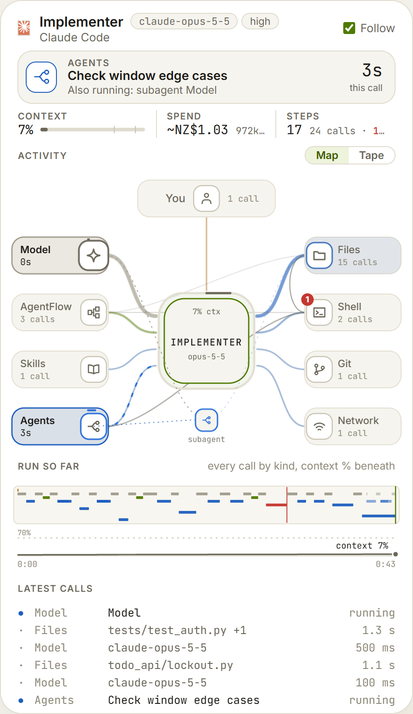

# The task page and the agent activity map

Since desktop 1.2.0, the task page shows what each running agent is doing, call by call, while it
works. The page has two columns: the workflow canvas, and the agent activity panel beside it.

## The canvas

The canvas draws the task's workflow graph: Architect, approvals, Implementer (or its workers),
checkpoint, Code and Security review, final verification and Ready for PR. It follows the app's theme,
so it is light in the light theme and dark in the dark theme.

- **The camera follows the work.** It centres on the stage that is running or waiting for you, and moves
  along as the task advances. Through a review fix loop, it moves from the Implementer to the two reviews
  and back. Pan or zoom and it stops following you; *Focus active* (or <kbd>F</kbd>) brings it back, and
  it picks up again when the stage changes. *Fit all* shows the whole graph, and the minimap shows where you are.
- **Agent cards show live work.** Each running agent's card shows its current call and its cost so far,
  below the usual header (harness, name, model and reasoning).
- **Batons on the edges.** When a stage hands its work to the next one, a baton travels along the edge
  with what was handed on, for example the checkpoint commit or the number of blocking findings.
- **Parallel workers.** Each Implementer worker shows a mini strip of its own activity, and a chip counts
  the workers running side by side.

The task's details (Node, Requirements, Findings, Lessons, Events and the rest) are in the **Details**
drawer, opened from the task header. It slides in from the right, like the terminal drawer, and only
one of the two is open at a time.

## The activity panel

<picture>
  <source media="(prefers-color-scheme: dark)" srcset="assets/activity-map-dark.png">
  
</picture>

The panel shows one agent's run: the running agent, unless you pick another. Untick **Follow** to stay
on the agent you picked. An agent that ran more than once has a tab per run.

- **Now:** the current call and how long it has been running, or what the agent is waiting for.
- **Vitals:** how full the context window is, the spend so far and the number of steps and calls,
  with failed calls counted.
- **Map:** the model in the middle of a hull, with a dock for each kind of work: You, AgentFlow,
  Skills and Agents on one side, Files, Shell, Git and Network on the other. Each call travels out to
  its dock and back. Each dock counts its calls, and a busy dock's cable wears in. A subagent appears
  as a pod on a tether. Waiting for you is amber; a failed call is red.
- **Tape:** the same calls as lanes over time, one lane per kind of work. The **Map | Tape** switch is
  remembered per viewer.
- **Run so far:** every call of the run by kind, with the context fill beneath.
- **Latest calls:** the newest calls with their dock, label and duration.

Drag the line between the canvas and the panel to resize it (380 to 640 px); double-click it to put it
back.

## Where the activity comes from

AgentFlow reads each agent's own transcript as it is written. It makes no model calls to do this, and the
agent does nothing extra.

| Harness | Read from | Live tokens and context | Cost |
|---|---|---|---|
| Claude Code | `~/.claude/projects/…/<session>.jsonl`, plus its subagent transcripts | yes | when the model's price is known |
| GitHub Copilot CLI | `~/.copilot/session-state/<id>/events.jsonl` | Copilot CLI 1.0.105 or later | none: Copilot bills premium requests |
| Codex CLI | `~/.codex/sessions/…` rollouts (built from Codex CLI 0.167.2) | yes | when the model's price is known |
| Any other CLI (`generic-cli`) | not read | | |

Claude's subagents and background agents, and Copilot's subagents, are tied to the call that started them.
A Codex script shows as one call, named after its first tool.

Only the desktop app (the Rust core) reads activity. The Python backend shows the panel's empty state.

## What is kept

Labels carry names only, never content: a file's last two path parts, a web host, a command or
subcommand name, a tool's name. Prompts show as "Prompt". Nothing of a command line, prompt or file is
logged or kept.

Updates reach the page over the existing websocket, at most once every 250 ms per run and only when
something changed. `GET /api/tasks/{key}/activity` returns every run's activity for a task.

## Known limits

- PowerShell commands such as `Get-Content` show on the Shell dock, not Files.
- Two Codex roles sharing one working folder get no activity, because their sessions cannot be told apart.
- Codex rollouts in the older `function_call` / `shell` format are not read.
